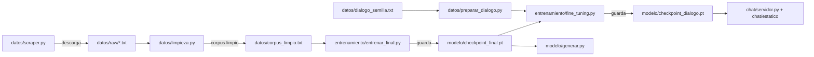

# mini-llm-desde-cero

Modelo de lenguaje entrenado **desde cero**, sin APIs de pago ni datasets preparados: scraping propio, tokenizador, dos arquitecturas (LSTM y Transformer), bucle de entrenamiento, fine-tuning de diálogo y una interfaz de chat. Todo implementado y explicado paso a paso como proyecto de aprendizaje.

## Qué es esto (y qué no es)

Un modelo de lenguaje a nivel carácter, entrenado sobre ~12,5 millones de caracteres de novelas en español de dominio público (Project Gutenberg), con una arquitectura Transformer decoder-only de ~824K parámetros. Después se le hace fine-tuning con un pequeño diálogo "tú / Quijote" y se sirve en una interfaz de chat web.

**No** es un competidor de ChatGPT ni pretende serlo. El objetivo es entender, construyendo cada pieza a mano, cómo funciona un LLM por dentro: scraping, limpieza, tokenización, embeddings, self-attention, entrenamiento por lotes, evaluación, fine-tuning y generación. La escala es deliberadamente pequeña para poder entrenar todo en una CPU normal.

## Arquitectura y flujo de datos



Resumen: *scraper → limpieza → corpus → entrenamiento del Transformer → fine-tuning con diálogo → chat web*.

## Estructura del proyecto

```
mini-llm-desde-cero/
├── datos/
│   ├── scraper.py            # descarga libros de Project Gutenberg por numero de eBook
│   ├── limpieza.py           # filtra por idioma, recorta boilerplate, normaliza vocabulario
│   ├── dialogo_semilla.txt   # 12 intercambios tu/quijote para el fine-tuning (versionado)
│   └── preparar_dialogo.py   # limpia la semilla con el mismo filtro que el corpus
├── modelo/
│   ├── tokenizador.py        # texto <-> indices, a nivel caracter
│   ├── embeddings_demo.py    # demo didactica de nn.Embedding
│   ├── lstm.py               # arquitectura recurrente (paso intermedio)
│   ├── transformer.py        # arquitectura final: self-attention causal, estilo mini-GPT
│   └── generar.py            # CLI de inferencia (texto libre o modo dialogo)
├── entrenamiento/
│   ├── entrenar.py           # LSTM vs Transformer sobre corpus de juguete
│   ├── entrenar_final.py     # entrenamiento real: batching, val split, warmup + cosine, clipping
│   └── fine_tuning.py        # ajuste con dialogo, lr bajo, sin tocar el modelo base
├── chat/
│   ├── servidor.py           # FastAPI: POST /api/chat con historial como contexto
│   └── estatico/index.html   # interfaz de chat
├── requirements.txt
└── .gitignore
```

## Las fases del aprendizaje

| # | Fase | Qué demuestra |
|---|------|----------------|
| 1 | Regresión lineal a mano (NumPy) | El ciclo forward → loss → gradiente → actualización |
| 2 | Modelo de n-gramas | Qué es "modelar lenguaje" sin redes, y el problema de los ceros |
| 3-4 | Tokenizador + embeddings | Texto → números → vectores entrenables; autodiff |
| 5 | LSTM | Estado oculto; overfitting visible en corpus pequeño |
| 6 | Transformer | Self-attention, embeddings posicionales, máscara causal |
| 7 | Scraping + limpieza | Corpus real y legal |
| 8 | Entrenamiento final | Batching, train/val, perplejidad, checkpoints, temperatura/top-k |
| 9 | Fine-tuning de diálogo | Adaptar un modelo ya entrenado con pocos datos y lr bajo |
| 10 | Chat web | Servir el modelo, historial como ventana deslizante de contexto |

## Resultados

| Ronda | Corpus | Iteraciones | Train loss | Val loss | Perplejidad val | Tiempo (CPU) |
|---|---|---|---|---|---|---|
| 1 | 2 libros (~2,7M car.) | 10.000 | 1.34 | 1.52 | 4.58 | 2 h 15 min |
| 2 | 12,5M caracteres | 16.000 (+ warmup, cosine, clipping) | 1.49 | 1.53 | 4.61 | 3 h 44 min |

Fine-tuning con 12 intercambios de diálogo: el loss baja de 1.88 a 0.25, y el modelo aprende el formato `tu: ... / quijote: ...` y a cortar su turno.

## Qué aprendí (y límites del enfoque)

**Más datos no arreglaron el estancamiento.** Al pasar de 2,7M a 12,5M de caracteres la perplejidad de validación no mejoró (4,58 → 4,61; no es una comparación exacta porque el conjunto de validación cambió). La pista está en el log: train loss y val loss casi coinciden (1.49 vs 1.53), es decir, **no hay overfitting, hay infraajuste**. Con 824K parámetros el modelo ya no puede aprender más de este texto; el cuello de botella es la capacidad, no los datos.

**Más datos sí cambiaron algo cualitativo:** el texto generado deja de ser solo Quijote y mezcla vocabulario de varios autores, pero sigue sin coherencia de frase.

**Por qué no "conversa" de verdad:**
- Escala: una ventana de 128 caracteres y menos de 1M de parámetros frente a cientos de millones o miles de millones en un LLM útil.
- Datos: un modelo entrenado con novelas aprende a continuar novelas, no a responder. Seguir instrucciones requiere muchos miles de ejemplos de diálogo, aquí hay 12.
- Conocimiento y razonamiento: no emergen a esta escala.

**Qué ayuda y qué no:**
| Palanca | Efecto esperado |
|---|---|
| Más libros | Poco, el modelo ya está limitado por capacidad |
| Decaimiento del lr + clipping | Estabiliza el final del entrenamiento, ganancia pequeña |
| Modelo mayor (p. ej. ~5M parámetros) + contexto 256 | Mejor ortografía y frases algo más largas; requiere GPU (Colab) |
| Tokenizador BPE | Cambio estructural más relevante: secuencias más cortas por el mismo texto |
| Partir de un modelo preentrenado (LoRA / fine-tuning) | Única vía realista a respuestas coherentes, deja de ser "desde cero" |

**Decisiones de diseño y su razón:**
- *Caracteres, no palabras ni BPE*: vocabulario de 56 símbolos y sin palabras desconocidas, a cambio de secuencias largas y de que el modelo tenga que aprender a deletrear.
- *Vocabulario filtrado en la limpieza*: la tabla de embeddings es de tamaño fijo; si la entrada contiene un carácter no visto en entrenamiento, el modelo no puede procesarlo. Por eso el chat normaliza la entrada (minúsculas, sin tildes ni signos).
- *Filtro por idioma en la limpieza* (`Language: Spanish` en la cabecera de Gutenberg): la lista de libros incluye IDs que no pude verificar uno a uno, así que el código descarta los que no sean en español.
- *Fine-tuning sobre texto concatenado con ventanas aleatorias*: entrenar con ejemplos aislados hacía que el modelo no aprendiera a terminar su turno.
- *Lr bajo en el fine-tuning (5e-5)*: evita olvidar lo aprendido (catastrophic forgetting).
- *Historial como ventana deslizante*: el modelo no tiene memoria; "recordar" es reenviarle los últimos 128 caracteres de la conversación.

## Cómo ejecutarlo

```powershell
python -m venv venv
.\venv\Scripts\Activate.ps1
pip install -r requirements.txt

# 1. Datos
python datos/scraper.py
python datos/limpieza.py

# 2. Entrenamiento (prueba corta primero)
$env:PRUEBA_RAPIDA="1"; python entrenamiento/entrenar_final.py
Remove-Item Env:\PRUEBA_RAPIDA
python entrenamiento/entrenar_final.py     # ~3,7 h en CPU con el corpus completo

# 3. Fine-tuning de diálogo
python datos/preparar_dialogo.py
python entrenamiento/fine_tuning.py

# 4. Chat
python chat/servidor.py                    # abre http://127.0.0.1:8000

# (opcional) Generar texto libre
python modelo/generar.py --texto "don quijote" --temperatura 0.6 --top-k 10
```

Si cambias el corpus, el vocabulario puede cambiar: hay que repetir también los pasos 3 y siguientes.

## Stack

Python, PyTorch, NumPy, Requests (scraping), FastAPI + Uvicorn (chat), HTML/JS sin framework.